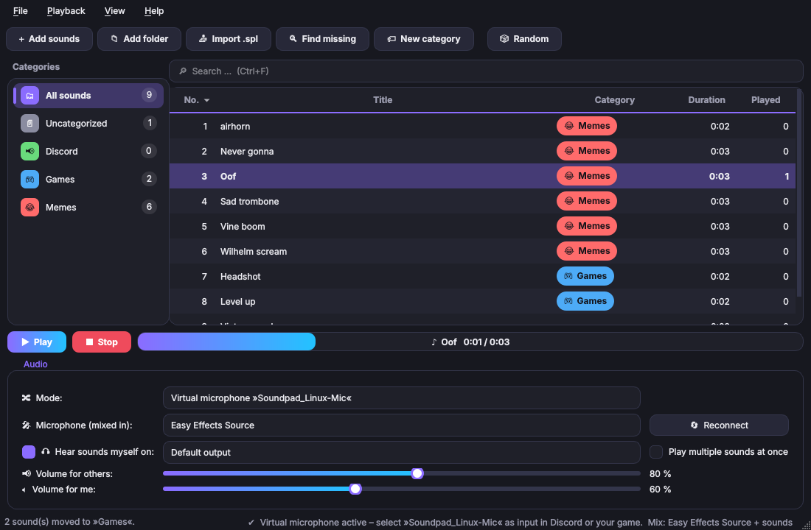

# Soundpad_Linux

A soundboard for Linux and an alternative to Soundpad. It plays sounds through a virtual microphone that also carries your real microphone (e.g. EasyEffects), so others in Discord, TeamSpeak or your game hear both. Existing Soundpad sound lists (`.spl`) can be imported directly.

> **Linux only.** The virtual microphone is built on PipeWire/PulseAudio. On Windows, use the original [Soundpad](https://store.steampowered.com/app/629520/Soundpad/).
>
> Unofficial project, not affiliated with Soundpad or Leppsoft.



## Features

- Sound list with number, title, category, duration and play count, plus search and sorting
- Categories with custom colors and emoji icons. Drag sounds onto a category to move them
- Import of Soundpad `.spl` files including categories and play counts. Windows paths (`C:\…`) are matched to files in a Linux folder by file name
- Add sounds as files, whole folders or via drag and drop
- Two audio modes: a virtual microphone **Soundpad_Linux-Mic** (your microphone + sounds), or injecting sounds straight into your existing microphone without creating a new device (experimental)
- Separate volume for others and for yourself, optional self-monitoring on any output device
- "Play only for me" to preview sounds
- Command line control for global hotkeys (works on Wayland too)
- Dark, light and system theme
- English and German interface
- Tray icon (optionally minimize to tray on close)

## Requirements

- Linux (Windows and macOS are not supported) with PipeWire (incl. `pipewire-pulse`) or PulseAudio
- Python ≥ 3.10 with PySide6
- `ffmpeg`/`ffprobe` and `pactl`/`pacat` (package `pulseaudio-utils`)
- for inject mode: `pw-dump`, `pw-link`, `pw-cat` (package `pipewire-utils`, PipeWire only)

## Installation

### Download (Fedora/Nobara)

1. Download `soundpad_linux-<version>.tar.gz` from the [latest release](https://github.com/newtox/soundpad_linux/releases/latest)
2. Extract it and run the installer:

```bash
tar xzf soundpad_linux-*.tar.gz
cd soundpad_linux-*/
./install.sh
```

### From the repository

```bash
git clone https://github.com/newtox/soundpad_linux.git
cd soundpad_linux
./install.sh
```

The script installs missing packages with `dnf`, copies the program to `~/.local/share/soundpad_linux`, creates the `soundpad_linux` command in `~/.local/bin` and adds an entry to your application menu.

To update, run `./install.sh` from a newer release (or after `git pull`). Uninstall with `./install.sh --uninstall`.

On other distributions, install the packages listed under [Requirements](#requirements) first, then run the script.

### pipx

```bash
pipx install git+https://github.com/newtox/soundpad_linux.git
```

Or install the `.whl` file from a release: `pipx install soundpad_linux-<version>-py3-none-any.whl`

`ffmpeg` and `pulseaudio-utils` still need to be installed through your package manager.

### Run without installing

```bash
PYTHONPATH=src python3 -m soundpad_linux
```

## Audio modes

Choose the mode in the *Audio* section of the window.

### Virtual microphone (default)

On startup Soundpad_Linux creates three modules via `pactl`:

```
Microphone (e.g. Easy Effects Source) ──loopback──┐
                                                  ├──> Soundpad_Linux-Mix ──> Soundpad_Linux-Mic  (select in Discord/game)
Sounds (volume "for others") ─────────────────────┘
Sounds (volume "for me") ──> your headphones
```

The modules are removed again when the app quits. Select **Soundpad_Linux-Mic** as the input device in Discord, TeamSpeak or your game, and others will hear you and your sounds.

### Inject into my microphone (experimental)

No new device is created. You keep your usual microphone in Discord (e.g. "Easy Effects Source" or "Default"), and Soundpad_Linux sends each sound directly to every app that is currently recording from the microphone you selected – similar to how Soundpad works on Windows.

Under the hood each sound is played with `pw-cat` without a target and then linked with `pw-link` to the input ports of those apps (found via `pw-dump`). This requires PipeWire. Apps that start recording while a sound is already playing only hear the next sound.

### EasyEffects

Choose "Easy Effects Source" as the microphone. It is picked automatically on first start if EasyEffects is running. If you start EasyEffects after Soundpad_Linux, click **Reconnect**.

### Tips

- Discord's own noise suppression (Krisp) can filter out sound effects. If sounds are cut off or very quiet for others, turn it off in Discord and use EasyEffects for noise reduction instead.
- If nothing arrives, check the status line at the bottom of the window and click **Reconnect**.

## Importing a Soundpad list

1. In Soundpad on Windows: *File → Save sound list as …* (or use your existing `soundlist.spl`)
2. Copy the sound files to Linux or mount your Windows partition
3. In Soundpad_Linux click **Import .spl**, choose the file, then choose the folder that contains your sounds

Files that couldn't be found are shown in red. Use **Find missing** to search more folders, or right-click a sound → *Relink file* to pick a file manually.

## Categories

- **New category** in the toolbar or right-click the category list
- Double-click a category (or right-click → *Edit category*) to change its name, color and icon
- Drag sounds from the list onto a category to move them, or right-click → *Move to category*
- New sounds are added to the currently selected category

## Hotkeys

Global hotkeys are set up in your desktop environment. In KDE Plasma go to *System Settings → Keyboard → Shortcuts → Add New → Command or Script* and use:

```bash
soundpad_linux --play 12          # sound no. 12
soundpad_linux --play-title bruh  # by title
soundpad_linux --random           # random sound
soundpad_linux --stop             # stop everything
```

Right-click a sound → *Copy hotkey command* puts the matching command on your clipboard.

Inside the window: **Enter/double-click** play, **Esc** stop, **F2** rename, **Del** remove, **Ctrl+F** search (Enter in the search box plays the first match), **Ctrl+R** random sound.

## Language and theme

Switch both under *View*. The default language is English; changing it requires a restart (the app offers to do that for you).

## Files

- Settings, categories and sound list: `~/.config/soundpad_linux/config.json`
- Supported formats: anything ffmpeg can read (mp3, wav, ogg, opus, flac, m4a, …)

## Development

```bash
python3 -m venv .venv && source .venv/bin/activate
pip install -e ".[dev]"
ruff check .
pytest
```

### Releasing a new version

1. Bump `__version__` in `src/soundpad_linux/__init__.py` and commit
2. Tag and push:

```bash
git tag v0.2.0
git push origin v0.2.0
```

GitHub Actions runs the tests, builds the release archive and the wheel, and publishes the release with generated notes.

### Project structure

```
src/soundpad_linux/
├── app.py              entry point and command line
├── constants.py        names, device labels, file formats
├── config.py           loading/saving settings, categories and sound list
├── categories.py       category colors and icons
├── i18n.py             translations
├── locales/            translation files (de.json, …)
├── theme.py            dark/light theme
├── spl.py              Soundpad .spl parser and file matching
├── audio.py            virtual microphone via pactl (PipeWire/PulseAudio)
├── pwgraph.py          inject mode: reading the PipeWire graph and linking ports
├── player.py           playback via ffmpeg + pacat
├── ipc.py              controlling a running instance (hotkey commands)
├── models.py           table model and filter
├── util.py             helpers
└── ui/
    ├── main_window.py    main window
    ├── category_dialog.py  category editor
    ├── delegates.py      colored category chips
    └── widgets.py        smaller widgets
```

### Adding a translation

1. Copy `src/soundpad_linux/locales/de.json` to `<code>.json` (e.g. `fr.json`)
2. Set `_language_name` and translate the values. Keep `{placeholders}` unchanged
3. Run `pytest`. It checks that every string is translated and the placeholders match

The new language shows up under *View → Language* automatically.

## License

[MIT](LICENSE)

## Contact

Justin – justin.lys26@gmail.com
